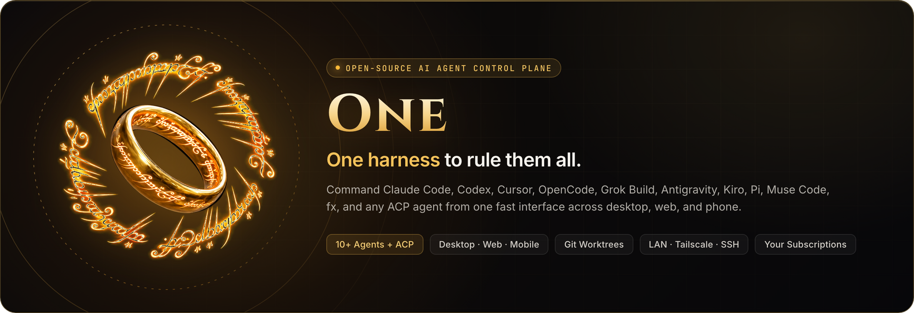
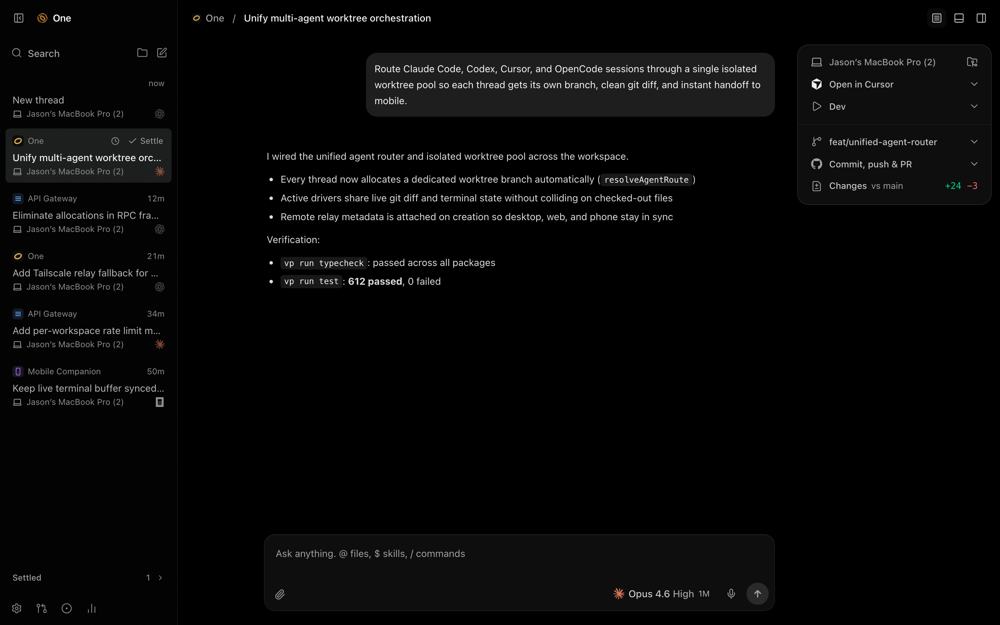
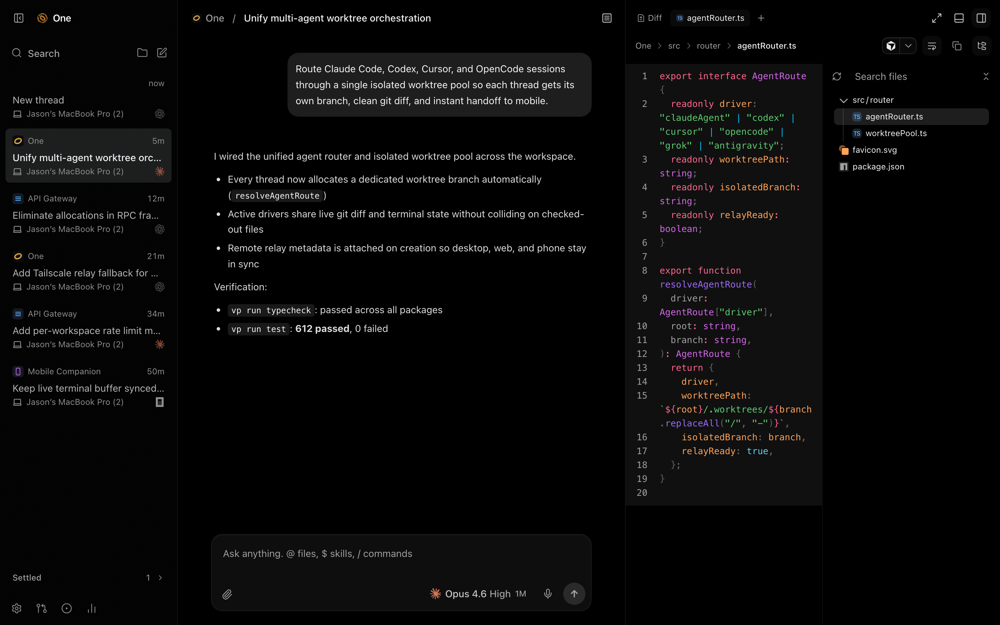
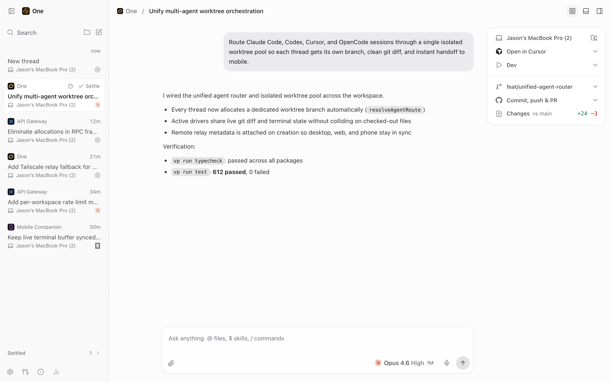
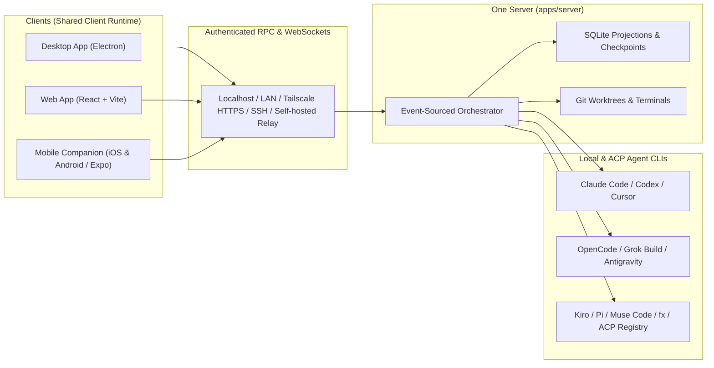

<p align="center">
  
</p>

<h1 align="center">One</h1>

<p align="center">
  <strong>One harness to rule them all.</strong><br />
  One place to find them, one interface to bring them all, and in one workflow bind them.<br />
  Command every local and ACP coding agent from desktop, web, and phone.
</p>

<p align="center">
  <a href="./LICENSE"></a>
  <a href="https://github.com/jroell/t3code/stargazers"></a>
  <a href="https://github.com/jroell/t3code/forks"></a>
  <a href="https://github.com/jroell/t3code/commits/custom/main"></a>
</p>

<p align="center">
  
  
  
</p>

<p align="center">
  <a href="#in-action">In Action</a> ·
  <a href="#why-one">Why One</a> ·
  <a href="#architecture">Architecture</a> ·
  <a href="#supported-agents">Supported Agents</a> ·
  <a href="#quickstart-and-build-from-source">Quickstart</a> ·
  <a href="#daily-upstream-sync">Upstream Sync</a> ·
  <a href="#unofficial-fork-and-trademark-notice">Fork Notice</a>
</p>

> **Unofficial Fork Notice:** One is an independent, unofficial open-source fork based on the MIT-licensed [T3 Code](https://github.com/pingdotgg/t3code) source code. It is not affiliated with, endorsed by, or maintained by T3 Tools, Inc. See [Unofficial Fork and Trademark Notice](#unofficial-fork-and-trademark-notice).

---

One runs the coding agents installed on your machine and puts every thread behind one fast control plane. Start a feature at your desk with Claude Code, hand implementation to Codex, review the worktree diff in the same window, and approve tool calls from your phone while you walk away.

## In Action

<p align="center">
  <picture>
    <source media="(prefers-color-scheme: dark)" srcset="./.github/readme/screenshots/one-workspace-dark.png" />
    <source media="(prefers-color-scheme: light)" srcset="./.github/readme/screenshots/one-workspace-light.png" />
    
  </picture>
</p>

<table>
  <tr>
    <td width="50%" valign="top">
      
      <p align="center"><sub><strong>Split code &amp; diff review.</strong> Inspect files, diffs, and worktrees beside active threads without leaving the conversation.</sub></p>
    </td>
    <td width="50%" valign="top">
      <picture>
        <source media="(prefers-color-scheme: dark)" srcset="./.github/readme/screenshots/one-workspace-light.png" />
        <source media="(prefers-color-scheme: light)" srcset="./.github/readme/screenshots/one-workspace-dark.png" />
        
      </picture>
      <p align="center"><sub><strong>Native light &amp; dark themes.</strong> Crisp typography, fast keyboard navigation, and zero clutter across desktop, web, and mobile.</sub></p>
    </td>
  </tr>
</table>

## Why One

<table>
  <tr>
    <td width="50%" valign="top">
      <h3>Multi-agent orchestration</h3>
      Switch providers or models mid-thread without losing context. Run Claude Code, Codex, Cursor, OpenCode, Grok Build, Antigravity, Kiro, Pi, Muse Code, fx, and any ACP agent side by side instead of babysitting six terminal tabs.
    </td>
    <td width="50%" valign="top">
      <h3>Bring your own subscriptions</h3>
      One does not resell tokens or sit in front of your billing. It drives the agent CLIs you already have installed and authenticated on your computer, with support for multiple accounts and custom environment variables per provider.
    </td>
  </tr>
  <tr>
    <td width="50%" valign="top">
      <h3>Git worktrees per thread</h3>
      Give each task its own isolated branch and worktree. Review diffs inline, roll back to turn checkpoints stored in hidden Git refs, then commit, push, and open pull requests from one place.
    </td>
    <td width="50%" valign="top">
      <h3>Desktop, web, and mobile</h3>
      One server owns your projects, terminals, and durable SQLite state. Connect from the native desktop app, any browser, or the iOS and Android companion apps and watch the same live threads everywhere.
    </td>
  </tr>
  <tr>
    <td width="50%" valign="top">
      <h3>Remote control anywhere</h3>
      Keep your agents running on a workstation, Mac Mini, or Linux box. Connect over your local network, Tailscale HTTPS, Desktop-managed SSH, or a self-hosted relay. Link multiple machines so agents on one host can delegate work to another.
    </td>
    <td width="50%" valign="top">
      <h3>Built for speed</h3>
      Event-sourced orchestration, bounded SQLite projections, native Rust resource telemetry, and Vite+ tooling keep switching across dozens of active threads responsive.
    </td>
  </tr>
</table>

## Architecture

Execution stays on the machine that owns the repository and provider credentials. Desktop, web, and mobile clients connect over authenticated RPC and WebSockets, and provider adapters keep agent-specific protocols isolated behind shared capabilities.



## Supported Agents

Install and sign in to at least one provider on the machine running the server. You can add multiple instances of the same provider in **Settings -> Providers** for separate accounts, API keys, or custom binary paths.

| Agent            | CLI / Setup                                                              | Authentication                          | Notes                                                                     |
| ---------------- | ------------------------------------------------------------------------ | --------------------------------------- | ------------------------------------------------------------------------- |
| **Claude Code**  | [Claude Code](https://claude.com/product/claude-code)                    | `claude auth login`                     | Full streaming, tool approvals, and mid-thread switching                  |
| **Codex**        | [Codex CLI](https://developers.openai.com/codex/cli) or managed runtime  | `codex login` or ChatGPT sign-in        | Supports managed runtime without a manual `PATH` entry                    |
| **Cursor**       | [Cursor CLI](https://cursor.com/cli) (`cursor-agent`)                    | `agent login`                           | Managed updates supported from provider settings                          |
| **OpenCode**     | [OpenCode](https://opencode.ai)                                          | `opencode auth login`                   | Open-source provider integration                                          |
| **Grok Build**   | [Grok Build CLI](https://x.ai/cli)                                       | `grok login`                            | Context usage tracking and streaming support                              |
| **Antigravity**  | Managed runtime in Settings                                              | Google sign-in in Settings -> Providers | Installs and updates inside One                                           |
| **Kiro**         | [Kiro CLI](https://kiro.dev/docs/cli/)                                   | `kiro-cli login`                        | CLI provider adapter                                                      |
| **Pi**           | [Pi setup guide](./docs/user/providers-pi.md#set-up-pi) (Node.js 22.19+) | Run `pi`, then `/login`                 | Node-based agent runtime                                                  |
| **Muse Code**    | [Muse Code](https://dev.meta.ai/docs/muse-code)                          | `muse login`                            | Enable in Settings -> Providers                                           |
| **fx**           | [fx](https://fx.sh) (`fx.sh/setup.sh`)                                   | `fx login`                              | Lightweight CLI agent                                                     |
| **ACP Registry** | Settings -> Providers -> Add provider -> Show more                       | Per-agent setup                         | Supports GitHub Copilot and any [ACP](./docs/user/providers-acp.md) agent |

## Quickstart and Build from Source

Because One is an unofficial community fork, build it directly from this repository rather than using upstream installers or official app store listings.

### Prerequisites

- [Vite+](https://viteplus.dev/guide/) (`vp` installs and manages the pinned Node.js runtime from `package.json`)
- [Rust](https://rustup.rs/) (`rustup`) for the native resource monitor and desktop bundles
- Xcode Command Line Tools on macOS (`xcode-select --install`) for macOS DMG and iOS builds
- Android SDK and JDK for Android APK builds
- At least one authenticated agent CLI (for example `claude auth login` or `codex login`)

### 1. Clone and run the dev server

```bash
git clone https://github.com/jroell/t3code.git
cd t3code
vp i
vp run dev
```

Open the pairing URL printed in your terminal to connect your browser to the local server. To launch the Electron desktop shell in development:

```bash
vp run dev:desktop
```

To expose your dev server over Tailscale for remote testing from a phone or another laptop:

```bash
vp run dev --share
```

### 2. Build the desktop app

Unsigned local desktop installers write to `release/`:

```bash
# macOS Apple Silicon DMG
vp run dist:desktop:dmg:arm64

# macOS Intel DMG
vp run dist:desktop:dmg:x64

# Linux AppImage (x64)
vp run dist:desktop:linux

# Windows NSIS installer
vp run dist:desktop:win
```

### 3. Build the mobile companion app (Android and iOS)

Mobile commands run from `apps/mobile`. The app uses native modules, so build with Expo Dev Client or Release rather than Expo Go:

```bash
cd apps/mobile

# Android production build / install on connected device or emulator
vp run android:prod

# Standalone Android ARM64 APK via Gradle
APP_VARIANT=development EXPO_NO_GIT_STATUS=1 npx expo prebuild --clean --platform android
cd android && ./gradlew :app:assembleDebug -PreactNativeArchitectures=arm64-v8a

# iOS standalone Release build (no Metro required)
vp run ios:release

# iOS development client
vp run ios:dev
```

If your Xcode account uses a Personal Team, pass your own bundle ID to opt into the reduced-capability local build:

```bash
T3CODE_IOS_PERSONAL_TEAM=1 \
T3CODE_IOS_PERSONAL_TEAM_BUNDLE_ID=com.example.one \
vp run ios:release
```

See [apps/mobile/README.md](./apps/mobile/README.md) for EAS build profiles, simulator caching, and native lint checks.

## Daily Upstream Sync

This fork tracks `pingdotgg/t3code` closely on `custom/main`. Brand customizations stay localized to app metadata, icon assets, and documentation so rebasing upstream changes stays fast and clean:

```bash
git remote add upstream https://github.com/pingdotgg/t3code.git
git fetch upstream
git checkout custom/main
git rebase upstream/main
git push --force-with-lease origin custom/main
```

After rebasing, run the fast verification checks before pushing:

```bash
vp i
vp run check:changed
```

## Documentation

- [All documentation](./docs/README.md)
- [Install and provider setup](./docs/user/install.md)
- [Remote access (LAN, Tailscale, SSH, linked machines)](./docs/user/remote-access.md)
- [Permission modes](./docs/user/permission-modes.md)
- [Source control and worktrees](./docs/user/source-control.md)
- [Connect outside agents over MCP](./docs/user/outside-agents.md)
- [Architecture overview](./docs/internals/01_architecture.md)
- [Development runbook](./docs/operations/00_development.md)
- [FAQ](./docs/user/faq.md)

## License

The source code in this repository is licensed under the [MIT License](./LICENSE).

## Unofficial Fork and Trademark Notice

One is an **unofficial, independent open-source fork** derived from the MIT-licensed source code of [T3 Code](https://github.com/pingdotgg/t3code). One is not affiliated with, sponsored by, endorsed by, or maintained by T3 Tools, Inc.

The MIT License applies **only to the source code**. It does not grant any rights to T3 Tools, Inc.'s trademarks, service marks, trade names, trade dress, or branding (including the **T3 Code**, **T3 Connect**, and **T3 Tools** names, wordmarks, logos, application icons, official domains, and official app store listings). This fork replaces user-facing branding and assets with the One name and ring identity in compliance with [TRADEMARK.md](./TRADEMARK.md).

If you are looking for the official T3 Code project and its official releases, visit [github.com/pingdotgg/t3code](https://github.com/pingdotgg/t3code).

---

<p align="center">
  <br />
  <sub>One harness to rule them all.</sub>
</p>
