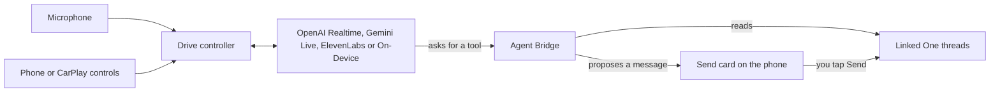

# One Drive and Apple CarPlay

One Drive is hands-free voice chat in the One mobile app for iOS and Android. On iOS it also has an Apple CarPlay screen. You can use it as a plain voice assistant, or link it to your One coding threads to hear what the agents are doing and to line up a follow-up message.

Drive never approves, declines or sends anything by voice alone. See [What voice can and cannot do](#what-voice-can-and-cannot-do).

## Open Drive

- **Settings -> Drive & CarPlay**
- **Settings -> Voice -> Open Drive & CarPlay**
- Search **carplay**, **drive**, **hands-free** or **voice studio** in Settings
- Deep link to `drive`

**Auto-Start on CarPlay Connect** is off by default. Turn it on in the Drive settings if you want a session to start when the phone connects to the car. If the phone cannot read its saved settings (for example while locked), Drive treats auto-start as off.

## How it works



## Voices

Drive has 29 voices from 4 providers, grouped by 6 vibes (`Warm`, `Crisp`, `Deep`, `Energetic`, `Calm`, `Narrative`).

| Provider            | Voices                    | Model or backend                                                      | How a turn works                                                                                                            | Key needed |
| ------------------- | ------------------------- | --------------------------------------------------------------------- | --------------------------------------------------------------------------------------------------------------------------- | ---------- |
| **OpenAI Realtime** | 10                        | `gpt-realtime` over WebSocket                                         | Two-way audio, 24 kHz                                                                                                       | OpenAI     |
| **Gemini Live**     | 10                        | `models/gemini-2.5-flash-native-audio-preview-09-2025` over WebSocket | Two-way audio, 16 kHz in, 24 kHz out                                                                                        | Gemini     |
| **ElevenLabs**      | 6, plus your own voice ID | `eleven_flash_v2_5` for speech                                        | One turn at a time. Replies come from OpenAI (`gpt-4o-mini`) or Gemini (`gemini-2.5-flash`) when one of those keys is saved | ElevenLabs |
| **On-Device**       | 3                         | The speech built into iOS or Android                                  | One turn at a time. Makes no cloud calls                                                                                    | None       |

In **Voices** you can filter by provider or vibe, pin favorites with the star, tap **Play Sample** to hear a voice, and tap **Use Voice** to switch, including during a session. Samples for cloud voices need that provider's key. Without it the sample plays in on-device speech.

### Keys

Save your OpenAI, Gemini and ElevenLabs keys in the setup drawer in Drive.

- Keys are stored with `expo-secure-store` (`WHEN_UNLOCKED_THIS_DEVICE_ONLY`). The screen only tracks whether a key is saved.
- Keys are not written to logs or error messages.
- If you pick a cloud voice with no key saved, Drive uses **On-Device** instead of failing.

## Personas

A persona sets how the assistant talks and how long its answers are. There are 7.

| Persona                   | Short name  | What it is for                                                           | Thread tools |
| ------------------------- | ----------- | ------------------------------------------------------------------------ | ------------ |
| **Road Co-Pilot**         | Co-Pilot    | General conversation, code or not                                        | On           |
| **One Agent Commander**   | Commander   | Thread briefings and follow-ups                                          | On           |
| **Architecture Sparring** | Architect   | Systems, APIs and trade-offs                                             | On           |
| **Creative Riff**         | Brainstorm  | Fast product and strategy ideas                                          | Off          |
| **Executive Briefing**    | Briefing    | Short answers, conclusion first                                          | On           |
| **Ring-Bearer**           | Ring-Bearer | Dry, brief company for late drives                                       | On           |
| **Conqueror**             | Conqueror   | Every report delivered as a decree, in a commanding arena-emperor manner | On           |

Conqueror is an original character. It sets the wording and manner, not the sound: pair it with a deep voice (the `Deep` vibe) for the full effect.

## What voice can and cannot do

With **Agent Bridge Tools** on and a computer linked, the assistant has four tools.

| Tool                     | What it does                                                            |
| ------------------------ | ----------------------------------------------------------------------- |
| `list_active_threads`    | Summarizes threads on linked computers, with running and waiting counts |
| `get_thread_summary`     | Reads the latest update on one thread in plain speech                   |
| `list_pending_approvals` | Says which threads are waiting on an approval                           |
| `send_message_to_thread` | Proposes a follow-up message. It does not send it                       |

Rules:

- **Approvals cannot be answered from Drive.** The assistant can tell you one is waiting. You answer it in the One app.
- **A message is sent only when you tap Send.** The assistant reads the whole message back and a card shows it on the phone. Saying "yes" does not send it. The card expires after 90 seconds, and a new proposal replaces the old one.
- **Messages are capped at 400 characters**, because the whole message has to be read back and shown.
- Spoken summaries leave out code blocks, markdown and raw URLs.
- With no computer linked, or with the tools off, Drive works as a plain voice chat and says so.

## CarPlay screen (iOS)

The CarPlay scene has four tabs:

1. **Talk**: status, current voice and persona, the focused thread and the latest caption, with Start, Mute, Interrupt and End.
2. **Voices**: pinned voices first, then the rest by vibe.
3. **Modes**: the personas.
4. **Threads**: linked threads with a status badge. Picking one focuses it and reads a short briefing.

Steering-wheel buttons: Play/Pause starts a session or toggles mute, Next interrupts the assistant, Previous repeats the last reply.

## Phone Drive

You do not need a car screen. Phone Drive has the ring that moves with the microphone and speaker level (still under Reduced Motion), large buttons, a keep-awake lock that is released when the session ends, a live caption with a transcript drawer, and a **CarPlay Preview** that mirrors the four CarPlay tabs.

Drive settings: **Hands-Free Barge-in**, **Auto-Start on CarPlay Connect**, **Agent Bridge Tools** and **Spoken Speed**.

If a realtime connection drops, Drive retries up to 3 times and then shows **Retry**.

## Known limits

These are not yet checked on a real car or device:

- The CarPlay screen has not been run on a head unit or in the CarPlay Simulator from this fork. It needs Apple's CarPlay entitlement (below).
- Echo cancellation depends on the phone and the car's audio route. With barge-in on, the car speakers can sometimes interrupt the assistant. Turn **Hands-Free Barge-in** off if that happens.
- Recovery after a phone call, Siri or navigation prompt, and after switching between Bluetooth and the speaker, has not been tested on hardware.
- If a thread changes on the computer between the proposal and your tap, Drive sends the message you saw to the thread you saw. It does not re-check what the agent did in between.

## Building and enabling Apple CarPlay

The Expo config plugin (`apps/mobile/plugins/withOneCarPlay.cjs`) wires the native scene manifest (`CPTemplateApplicationSceneSessionRoleApplication` -> `OneCarPlaySceneDelegate`, `UIApplicationSupportsMultipleScenes: true`), `UIBackgroundModes: ["audio"]`, and Android microphone permissions (`RECORD_AUDIO`, `MODIFY_AUDIO_SETTINGS`) automatically during prebuild.

### Default and Personal Team local builds (no CarPlay entitlement)

By default, and whenever `T3CODE_IOS_PERSONAL_TEAM=1` is set, the config plugin **omits** Apple's restricted CarPlay entitlements so local Xcode signing succeeds without an approved CarPlay provisioning profile.

Phone Drive Mode, the 29 voices, Voice Studio, Agent Bridge and the CarPlay Preview all work in standard local and Personal Team builds.

```bash
cd apps/mobile

# Local iOS build (no CarPlay entitlement requested)
vp run ios:release

# Personal Team local build
T3CODE_IOS_PERSONAL_TEAM=1 \
T3CODE_IOS_PERSONAL_TEAM_BUNDLE_ID=com.example.one \
vp run ios:release
```

### Enabling native CarPlay with Apple's entitlement

To show One on a physical Apple CarPlay head unit or in Xcode's CarPlay Simulator, your Apple Developer account needs an approved CarPlay entitlement assigned to your App ID and provisioning profile:

1. Request CarPlay access for your team through Apple's [CarPlay entitlement request](https://developer.apple.com/contact/carplay/) page (request **Communication** for `com.apple.developer.carplay-communication` or **Audio** for `com.apple.developer.carplay-audio`).
2. Once Apple approves the entitlement, enable it on your App ID in Certificates, Identifiers & Profiles and regenerate your provisioning profile.
3. Build from `apps/mobile` with `ONE_CARPLAY_ENTITLEMENT` set:

```bash
cd apps/mobile

# Communication entitlement (com.apple.developer.carplay-communication)
ONE_CARPLAY_ENTITLEMENT=1 vp run ios:release

# Or Audio entitlement (com.apple.developer.carplay-audio)
ONE_CARPLAY_ENTITLEMENT=audio vp run ios:release

# Or both entitlements
ONE_CARPLAY_ENTITLEMENT=both vp run ios:release
```

Note: `T3CODE_IOS_PERSONAL_TEAM=1` always takes precedence and strips CarPlay entitlements so Personal Team builds never fail code signing.

For general mobile build profiles, simulator caching, and Android APK steps, see [apps/mobile/README.md](../../apps/mobile/README.md) and [Voice input](./voice-input.md).
