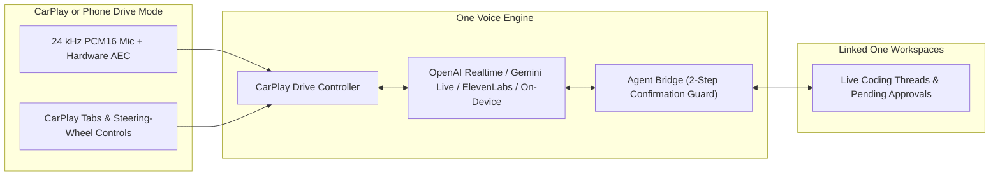

# One Drive and Apple CarPlay Voice Companion

One Drive is a hands-free realtime voice companion built into the One mobile app for iOS and Android, with native Apple CarPlay support on iOS. Use it as a standalone conversational voice assistant on the road, or bridge it to your live One coding threads to hear status briefings, check pending approvals, and steer running agents without touching a screen.

## Open Drive Mode

You can open Drive Mode from any of these entry points in the mobile app:

- **Settings -> Drive & CarPlay**
- **Settings -> Voice -> Open Drive & CarPlay**
- Search **carplay**, **drive**, **hands-free**, **realtime voice**, or **voice studio** in Settings
- Deep link to `drive`

When your iPhone connects to an Apple CarPlay head unit and **Auto-Start on CarPlay Connect** is on (enabled by default), One can launch your voice session automatically.

## How it works



## Supported voice providers and catalog

One ships with **29 curated voices** across **4 providers** and **6 vibes** (`Warm`, `Crisp`, `Deep`, `Energetic`, `Calm`, `Narrative`).

| Provider            | Voices                                                                                             | Default model / backend                                                                  | Transport                                                                                                                                                                | API key required   |
| ------------------- | -------------------------------------------------------------------------------------------------- | ---------------------------------------------------------------------------------------- | ------------------------------------------------------------------------------------------------------------------------------------------------------------------------ | ------------------ |
| **OpenAI Realtime** | 10 (`Marin`, `Cedar`, `Coral`, `Ash`, `Ballad`, `Sage`, `Shimmer`, `Verse`, `Alloy`, `Echo`)       | `gpt-realtime` (`wss://api.openai.com/v1/realtime`)                                      | Full-duplex WebSocket, 24 kHz PCM16, `semantic_vad` or `server_vad`                                                                                                      | OpenAI API key     |
| **Gemini Live**     | 10 (`Puck`, `Charon`, `Kore`, `Fenrir`, `Aoede`, `Leda`, `Orus`, `Zephyr`, `Enceladus`, `Umbriel`) | `models/gemini-2.5-flash-native-audio-preview-09-2025` (`BidiGenerateContent` WebSocket) | Full-duplex WebSocket, 16 kHz mic input (resampled from 24 kHz), 24 kHz audio output                                                                                     | Gemini API key     |
| **ElevenLabs**      | 6 (`Rachel`, `Adam`, `Bella`, `Antoni`, `Elli`, `Josh`) plus optional custom voice ID              | `eleven_flash_v2_5` (`pcm_24000`)                                                        | Turn-based RMS VAD with ElevenLabs PCM playback; uses OpenAI (`gpt-4o-mini`) or Gemini (`gemini-2.5-flash`) for replies when configured, plus local Agent Bridge intents | ElevenLabs API key |
| **On-Device**       | 3 (`On-Device Pilot`, `On-Device Calm`, `On-Device Brief`)                                         | Native iOS `AVSpeechSynthesizer` / Android `TextToSpeech`                                | Turn-based zero-key fallback with local Agent Bridge thread and approval checks                                                                                          | None               |

### Voice Studio and auditions

Open **Voices** from Drive Mode to browse the full catalog:

- Filter by provider (`All`, `OpenAI Realtime`, `Gemini Live`, `ElevenLabs`, `On-Device`), by vibe, or by **Pinned** favorites.
- Tap the star on any voice to pin it to the top of your CarPlay **Voices** tab. Default favorites are `Marin`, `Cedar`, `Puck`, and `On-Device Pilot`.
- Tap **Play Sample** to audition any voice before switching. OpenAI voices audition through `gpt-4o-mini-tts` and ElevenLabs voices audition through `eleven_flash_v2_5` when their keys are configured; if offline or unconfigured, auditions fall back automatically to native on-device speech.
- Tap **Use Voice** to switch voices immediately, including in the middle of an active call. OpenAI updates the live session in place; Gemini Live reconnects cleanly with the new voice.

### API key storage and automatic fallback

Configure your OpenAI, Gemini, and ElevenLabs keys inside the **Voice & CarPlay Setup Drawer** (accessible from the setup button in Drive Mode).

- Keys are stored strictly in `expo-secure-store` using `WHEN_UNLOCKED_THIS_DEVICE_ONLY`.
- Inputs are masked with reveal, save, and clear actions, and UI state tracks only whether a key is configured, never the raw secret.
- Raw keys are never written to logs or error messages.
- If you select a cloud voice without its API key saved, One falls back to **On-Device** mode instead of blocking your session.

## CarPlay dashboard layout

When connected to Apple CarPlay, `OneCarPlaySceneDelegate` presents a 4-tab `CPTabBarTemplate` built for eyes-free driving:

1. **Talk (`CPInformationTemplate` + `CPNowPlayingTemplate`)**: Shows live status (`Ready`, `Connecting...`, `Listening`, `Thinking`, `Speaking`, `Muted`, `Reconnecting`), active voice and mode, active topic or thread, and the latest spoken caption. When idle, tap **Start Talking** or **Now Playing**. During an active call, tap **Mute** / **Unmute**, **Interrupt**, or **End**. The **Now Playing** screen renders the gold-on-obsidian One Ring artwork and 4 quick action buttons: Mute/Unmute, Interrupt, Switch Voice (cycles pinned voices first), and End Session.
2. **Voices (`CPListTemplate`)**: Lists your pinned favorites first, followed by the remaining catalog grouped by vibe. Tapping a voice switches immediately and previews it aloud when idle.
3. **Modes (`CPListTemplate`)**: Switches between the 6 driving personas in one tap.
4. **Threads (`CPListTemplate`)**: Lists active One workspace threads with status badges (`Needs Approval`, `Running`, `Ready`, `Error`). Tapping a thread focuses it, pushes the Now Playing screen, and speaks a 2-sentence status briefing including any pending approvals.

### Driving personas

| Persona                   | Short name  | Focus                                                                | Default Agent Bridge tools | Target length     |
| ------------------------- | ----------- | -------------------------------------------------------------------- | -------------------------- | ----------------- |
| **Road Co-Pilot**         | Co-Pilot    | General hands-free conversation on code or non-code topics           | On                         | 2 to 4 sentences  |
| **One Agent Commander**   | Commander   | Live thread briefings, pending approvals, and follow-up instructions | On                         | Up to 4 sentences |
| **Architecture Sparring** | Architect   | Systems, APIs, latency, failure modes, and trade-offs                | On                         | Up to 4 sentences |
| **Creative Riff**         | Brainstorm  | Fast product and strategy ideation with at most two options per turn | Off                        | Up to 3 sentences |
| **Executive Briefing**    | Briefing    | Bottom-line answers first with zero filler                           | On                         | Up to 2 sentences |
| **Ring-Bearer**           | Ring-Bearer | Dry, concise companion for late-night drives                         | On                         | Up to 3 sentences |

### Steering-wheel controls

One registers `MPRemoteCommandCenter` handlers so physical steering-wheel buttons work without looking at the dash:

- **Play / Pause**: Starts a voice session when idle, or toggles mute and unmute during an active call.
- **Next Track**: Interrupts the assistant immediately (barge-in) and flushes queued speaker audio.
- **Previous Track**: Repeats the last assistant reply aloud, or asks for a quick recap if no prior reply is cached.

### Audio engine, echo cancellation, and barge-in

- **iOS (`OneCarPlayAudioEngine.swift`)**: Runs `AVAudioEngine` in `.playAndRecord` with `.voiceChat` mode so hardware Acoustic Echo Cancellation (AEC) prevents cabin speakers from triggering false interruptions. Supports Bluetooth HFP, Bluetooth A2DP, and speaker routing, captures 24 kHz mono PCM16 chunks with live RMS metering, and streams 24 kHz PCM16 playback through `AVAudioPlayerNode`.
- **Android (`OneCarPlayAudioEngine.kt`)**: Runs `AudioRecord` with `VOICE_COMMUNICATION`, `AcousticEchoCanceler`, and `NoiseSuppressor`, paired with a low-latency streaming `AudioTrack` (`USAGE_VOICE_COMMUNICATION`) and audio focus management.
- **Instant barge-in**: Speaking over the assistant (when **Hands-Free Barge-in** is enabled) or pressing Interrupt clears the native playback queue immediately and cancels the in-flight response.
- **System interruptions**: Incoming phone calls, Siri, or turn-by-turn navigation prompts automatically mute capture and flush playback, then resume cleanly when the interruption ends.
- **Automatic reconnect**: If a realtime WebSocket drops unexpectedly mid-drive, One retries up to 3 times with exponential backoff before surfacing a one-tap **Retry** banner.

## Phone Drive Mode and CarPlay Preview

You do not need a CarPlay head unit to use One Drive. Phone Drive Mode gives iOS and Android drivers the same realtime engine with dash-safe ergonomics:

- **Animated One Ring Voice Orb**: Pulses smoothly with live microphone and speaker RMS amplitude and changes color by state (`Listening`, `Thinking`, `Speaking`, `Muted`, `Connecting`), while respecting the system Reduced Motion setting.
- **Large touch targets**: Every primary dock control meets or exceeds a 64 px hit target (76 px for the main **Start Hands-Free Chat** button) with tactile haptic feedback.
- **Keep Awake**: Keeps the screen from dimming while a voice session is active, and releases the wake lock as soon as you end the call.
- **Live caption ticker and Transcript Drawer**: Shows a 2-line live caption under the orb; tap it to open the scrollable transcript drawer or send a quick text turn.
- **Interactive CarPlay Preview**: Inside the setup panel, a 16:9 widescreen simulator mirrors your live CarPlay **Talk**, **Voices**, **Modes**, and **Threads** tabs so you can test layouts, switch voices, and verify thread sync directly on your phone.
- **Drive settings**: Toggle **Hands-Free Barge-in**, **Auto-Start on CarPlay Connect**, and **Agent Bridge Tools**, and adjust **Spoken Speed** (`0.85x`, `1.0x`, `1.15x`, `1.25x`, `1.4x`).

## Voice Agent Bridge safety

When **Agent Bridge Tools** is enabled and a computer is linked to One, the voice assistant has access to 5 structured tools:

| Tool                     | Type                     | Behavior                                                                                       |
| ------------------------ | ------------------------ | ---------------------------------------------------------------------------------------------- |
| `list_active_threads`    | Read-only                | Summarizes active threads across linked computers, running counts, and pending approval counts |
| `get_thread_summary`     | Read-only                | Reads the latest assistant update and pending approval on a named thread in plain speech       |
| `list_pending_approvals` | Read-only                | Lists pending permission or command requests waiting on your decision                          |
| `send_message_to_thread` | Side-effectful (guarded) | Sends a follow-up prompt to a linked coding thread                                             |
| `respond_to_approval`    | Side-effectful (guarded) | Submits `accept`, `acceptForSession`, `decline`, or `cancel` for a pending approval            |

### Two-step confirmation before any side effect

`send_message_to_thread` and `respond_to_approval` never run on the first invocation:

1. The first tool call creates a pending confirmation that expires after 90 seconds, speaks the exact proposed action aloud, and displays an **Approve** / **Cancel** card on the Drive Stage screen.
2. The action only executes after you verbally confirm it (so the model retries with `confirmed: true` and the matching `confirmationId`) or tap **Approve** on screen.
3. Saying cancel, tapping **Cancel**, or letting the 90-second window expire discards the pending action without touching your coding thread.

### Spoken-friendly summaries and standalone fallback

- All persona prompts and `sanitizeForSpeech` strip code fences, inline backticks, markdown headers, bullet symbols, and raw URLs so the assistant summarizes changes in plain English instead of reading diffs or file paths aloud.
- If no computer is connected to One, or if you disable **Agent Bridge Tools**, the assistant tells you plainly and continues working as a standalone hands-free voice chat.

## Building and enabling Apple CarPlay

The Expo config plugin (`apps/mobile/plugins/withOneCarPlay.cjs`) wires the native scene manifest (`CPTemplateApplicationSceneSessionRoleApplication` -> `OneCarPlaySceneDelegate`, `UIApplicationSupportsMultipleScenes: true`), `UIBackgroundModes: ["audio"]`, and Android microphone permissions (`RECORD_AUDIO`, `MODIFY_AUDIO_SETTINGS`) automatically during prebuild.

### Default and Personal Team local builds (no CarPlay entitlement)

By default, and whenever `T3CODE_IOS_PERSONAL_TEAM=1` is set, the config plugin **omits** Apple's restricted CarPlay entitlements so local Xcode signing succeeds without an approved CarPlay provisioning profile.

Phone Drive Mode, the full 29-voice catalog, Voice Studio, Agent Bridge, and the interactive CarPlay Preview all work in standard local and Personal Team builds.

```bash
cd apps/mobile

# Local iOS build (no CarPlay entitlement requested)
vp run ios:release

# Personal Team local build
T3CODE_IOS_PERSONAL_TEAM=1 \
T3CODE_IOS_PERSONAL_TEAM_BUNDLE_ID=com.example.one \
vp run ios:release
```

### Enabling native CarPlay with Apple's entitlement

To show One on a physical Apple CarPlay head unit or in Xcode's CarPlay Simulator, your Apple Developer account needs an approved CarPlay entitlement assigned to your App ID and provisioning profile:

1. Request CarPlay access for your team through Apple's [CarPlay entitlement request](https://developer.apple.com/contact/carplay/) page (request **Communication** for `com.apple.developer.carplay-communication` or **Audio** for `com.apple.developer.carplay-audio`).
2. Once Apple approves the entitlement, enable it on your App ID in Certificates, Identifiers & Profiles and regenerate your provisioning profile.
3. Build from `apps/mobile` with `ONE_CARPLAY_ENTITLEMENT` set:

```bash
cd apps/mobile

# Communication entitlement (com.apple.developer.carplay-communication)
ONE_CARPLAY_ENTITLEMENT=1 vp run ios:release

# Or Audio entitlement (com.apple.developer.carplay-audio)
ONE_CARPLAY_ENTITLEMENT=audio vp run ios:release

# Or both entitlements
ONE_CARPLAY_ENTITLEMENT=both vp run ios:release
```

Note: `T3CODE_IOS_PERSONAL_TEAM=1` always takes precedence and strips CarPlay entitlements so Personal Team builds never fail code signing.

For general mobile build profiles, simulator caching, and Android APK steps, see [apps/mobile/README.md](../../apps/mobile/README.md) and [Voice input](./voice-input.md).
