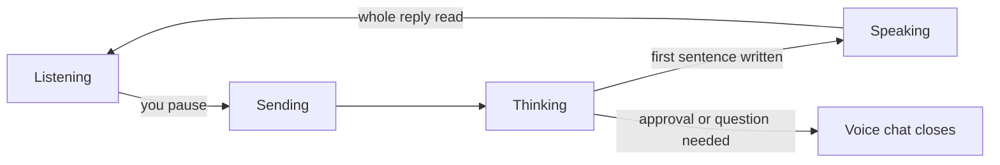

# Chat mode and voice chat

One has two ways to look at a thread. Code mode is the full workspace: thread details, terminal, diffs and panels. Chat mode shows the same thread as a conversation, set in a narrower reading column with larger text, for learning, brainstorming and thinking out loud. Switching modes never changes the thread, only how it is shown on this device.

## Switch modes

- Use the **Code / Chat** switch at the top right of a thread.
- Press `Cmd+Option+Shift+C` (`Ctrl+Alt+Shift+C` on Windows and Linux).
- Open the command palette and choose **Switch to Chat mode** or **Switch to Code mode**.

In Chat mode a new thread opens with a greeting and a few ways to start. Each one puts the start of a sentence in the composer for you to finish, for example "Teach me about ". Panels you had open in Code mode stay open, and their toggles stay visible so you can close them.

## Voice chat

Voice chat is a spoken conversation in the current thread. You talk, One sends what you said when you pause, and the reply is read aloud. Everything said lands in the thread as normal messages.

- Start it with **Talk instead** on the welcome screen, the voice button next to the mode switch, the command palette, or `Cmd+Option+V` (`Ctrl+Alt+V`). The shortcut also ends it.
- Press the ring to send right away instead of waiting for a pause, or to stop the reading and speak again.
- Press `Esc` or **End voice chat** to leave. Leaving always turns the microphone off.

Things to know:

- Voice chat uses the voice input you set up in **Settings -> Voice**. If no transcription is set up, starting voice chat opens that setup.
- Send or clear a draft first. Voice chat sends only what you say, so it will not start while the composer holds text or attachments.
- If the agent needs an approval or an answer, voice chat closes so you can respond on the page.
- Voice chat belongs to one thread. Opening another thread or switching to Code mode ends it.
- Reading starts as soon as the agent has written its first sentence and keeps up as it writes more. If the agent answers again after a tool call, that answer is read next. Code blocks are skipped.
- Replies are read in the voice you pick under **Settings -> Voice -> Reading aloud**. See [Read replies aloud](./voice-input.md#read-replies-aloud).
- A short question ends after a brief pause; a longer one gets a little more time. Steady background noise, such as a fan, does not keep the turn open.

## The opening

When One starts, the ring ignites out of a black screen and the app appears. Any key or click skips it. It plays once per app session and never under your system's reduced motion setting. Turn the animation or its sound off in **Settings -> Appearance** (**Opening animation**, **Opening sound**), where **Play it now** also replays it.

## Themes

The ring, the glass edges and the glows take their color from the active theme, including themes you create. The standard One theme is black and gold when dark, and white and gold when light.
